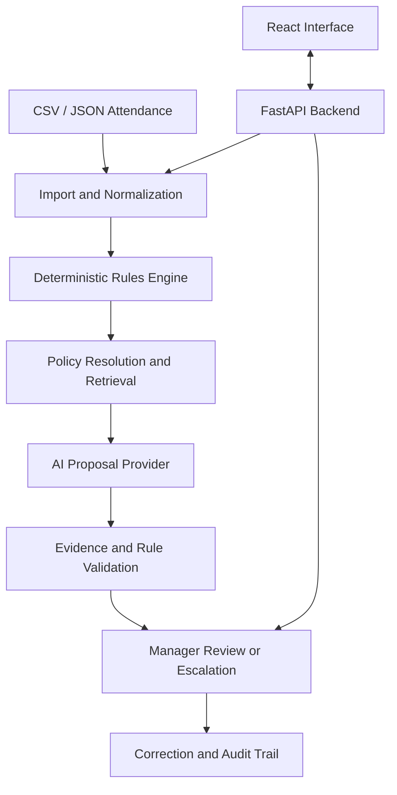

# Resolva — Timecard Exception Resolution Agent

Resolva helps managers review and resolve attendance issues such as missing
clock-outs, overlapping shifts, missed breaks, and overtime risks.

It combines deterministic attendance rules with policy-grounded AI suggestions.
Each suggestion is validated before a manager approves, edits, or rejects it.
Original attendance records remain unchanged, and every correction is audited.

**AI drafts. Rules verify. The manager decides.**

## What Resolva Does

- Detects six types of timecard exceptions using configurable rules.
- Imports CSV and JSON attendance data into a shared format.
- Retrieves relevant clauses from the employee’s applicable policy version.
- Proposes corrections with supporting evidence and policy citations.
- Escalates cases with missing information or conflicting evidence.
- Supports planned manager queries in English, Kannada, and Hindi.
- Records corrections, approvals, and validation results in an audit trail.

| Exception | What it identifies |
| --- | --- |
| Missing punch | A clock-in or clock-out without its matching event |
| Overlapping shift | Worked shifts that overlap |
| Meal-break breach | Attendance that does not meet configured break rules |
| Overtime risk | Worked and scheduled hours exceeding configured limits |
| Spread-over breach | Excessive time between the first clock-in and last clock-out |
| Schedule deviation | Late arrival, early departure, or an unscheduled shift |

## How It Works

1. **Import attendance:** upload CSV or JSON and review the import preview.
2. **Normalize records:** validate employee IDs, timestamps, and event types.
3. **Detect exceptions:** compare attendance with schedules and policy rules.
4. **Retrieve evidence:** select the applicable policy and supporting clauses.
5. **Generate a proposal:** the AI suggests a structured, evidence-backed action.
6. **Validate the change:** verify citations and rerun the attendance rules.
7. **Review and decide:** a manager approves, edits, rejects, or escalates.
8. **Record the outcome:** save the correction and its complete audit history.

A proposal cannot become eligible for approval simply because the model reports
high confidence. Missing evidence, invalid citations, or failed rules block it.

## Architecture

Resolva uses a modular monolith: one React application, one FastAPI backend,
and local storage for attendance records and searchable policy content.



| Component | Responsibility | Proposed technology |
| --- | --- | --- |
| Web interface | Exception inbox, evidence, and manager decisions | React, TypeScript, Vite |
| UI components | Accessible forms, tables, and review panels | Tailwind CSS, shadcn/ui |
| Backend | APIs, permissions, and workflow coordination | FastAPI, Pydantic |
| Rules engine | Exception detection and correction validation | Python |
| Database | Attendance, proposals, corrections, and audit events | SQLite, SQLModel |
| Policy retrieval | Version-filtered keyword and semantic search | ChromaDB |
| AI provider | Structured correction proposals | Ollama or Groq |
| Tests | Rule, API, safety, and user-flow verification | pytest, Playwright |

The AI provider cannot directly modify attendance records.
Detection and validation reuse the same rule functions.
Corrections are appended as new records rather than overwriting original punches.

## Install and Run Locally

> The commands below describe the intended Docker setup.
> They will become runnable when the application and packaging are implemented.

### Requirements

- Git
- Docker Desktop with Docker Compose
- A configured model provider for AI-generated proposals

### 1. Clone the Repository

```bash
git clone https://github.com/amulyaa-mohan/Resolva-Timecard-Exception-Resolution-Agent.git
cd Resolva-Timecard-Exception-Resolution-Agent
git switch cv-jayanth
```

### 2. Configure the Application

The planned `.env.example` file will document the required settings.

```bash
cp .env.example .env
```

Configure the model provider and its connection settings in `.env`.
Keep API keys out of version control.
Use synthetic attendance data for the demonstration.

### 3. Start the Application

The planned Compose configuration will start the frontend and backend.

```bash
docker compose up --build
```

Local URLs and any model-download or database-seeding steps will be documented
once the startup configuration is implemented and verified.

### 4. Try the Workflow

1. Open the web application at the address shown during startup.
2. Load the demonstration dataset or import a supported attendance file.
3. Open an exception and inspect its attendance and policy evidence.
4. Generate a proposal and review its validation results.
5. Approve a valid correction and inspect the resulting audit history.

If AI is unavailable, deterministic detection and manual review should remain
available, with all corrections subject to validation and audit requirements.

### 5. Stop the Application

```bash
docker compose down
```

## Safety and Scope

Pay-affecting corrections require explicit approval from an authorized manager.
The prototype uses simplified demonstration policies and synthetic records.
It does not calculate or export payroll, certify legal compliance, or include
production HRMS and biometric-device integrations.
