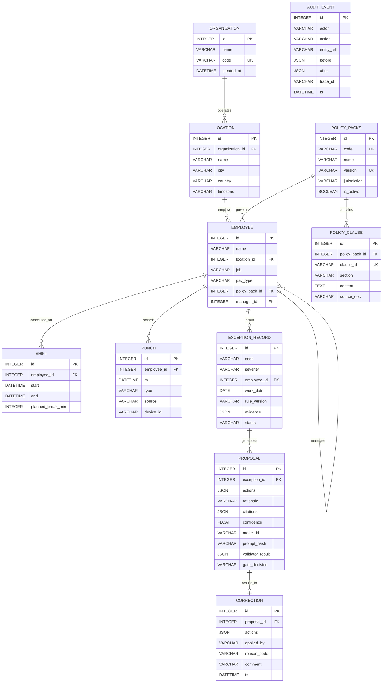

# Resolva Database Entity-Relationship Diagram (ERD)

The following Mermaid diagram visualizes the complete entity relationships, cardinalities, foreign key connections, and primary keys across the 11 tables in the Resolva database.

---

## Cardinality Summary

| Relationship | Cardinality | Business Meaning |
|---|---|---|
| `organization -> location` | $1 : N$ | An organization operates one or more physical locations. |
| `location -> employee` | $1 : N$ | An employee is assigned to a home location with an associated timezone. |
| `policy_packs -> policy_clause` | $1 : N$ | A jurisdictional policy pack groups multiple statutory clauses. |
| `policy_packs -> employee` | $1 : N$ | Each employee is governed by a statutory compliance pack based on work location. |
| `employee -> employee` | $0..1 : N$ | Self-referencing reporting hierarchy (employees report to a manager). |
| `employee -> shift` | $1 : N$ | An employee has scheduled shifts across the payroll cycle. |
| `employee -> punch` | $1 : N$ | Physical or virtual clock taps captured for an employee. |
| `employee -> exception_record` | $1 : N$ | Timecard anomalies detected against scheduled shifts and clock punches. |
| `exception_record -> proposal` | $1 : N$ | An exception can have AI resolution proposals generated for it. |
| `proposal -> correction` | $1 : 0..1$ | An approved proposal spawns exactly one timecard correction record. |
| `audit_event` | Independent Ledger | Append-only ledger linking to any entity via `entity_ref` (e.g., `proposal:1`). |
